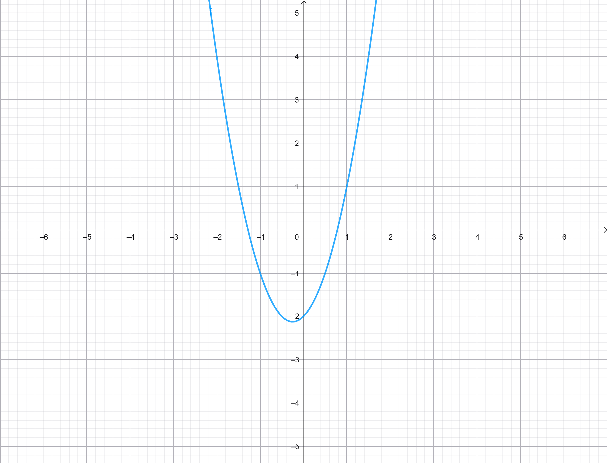

+++
titel = "UI-Test Baustein"
in-uebersicht = false
+++

# "Zwei gleiche Spalten"

Text über die gesamte Breite.

## Links: "Links beschriftet"

Linke Spalte mit $x^2$.

!

## Rechts: "Rechts beschriftet"

Rechte Spalte.

::platz

---

Text nach dem expliziten Spaltenende.

::bis 3:00

::notiz
Private Notiz zur Spaltenfolie.

# "Zwei Drittel und ein Drittel"

## Links Mitte

Breiter linker Bereich.

!

## Rechts

Schmaler rechter Bereich.

### "Sichtbare Zwischenüberschrift"

Normaler Inhalt.

::bis 5:00

# "Ein Drittel und zwei Drittel"

## Links

Schmaler linker Bereich.

## Mitte Rechts

Breiter rechter Bereich mit Tabelle.

| A | B |
| --- | --- |
| 1 | 2 |

::bis 7:00

# "Drei Spalten"

## Links

Links.

## Mitte

Mitte.

## Rechts

Rechts.

::bis 9:00

# "Alias-Test links"

## Mitte Links

Alias für `## Links Mitte`.

## Rechts

Rechter Bereich.

::bis 10:00

# "Alias-Test rechts"

## Links

Linker Bereich.

## Rechts Mitte

Alias für `## Mitte Rechts`.

::bis 11:00

# "Merkkarten auf einer Folie"

Text über den Karten.

::merkkarte "Testregel Eins"

Text zwischen den Karten, danach Platz zum Schreiben.

::platz 2

::bis 12:30

# "Folie mit Etikett"

::tag Einstieg

Eine Folie mit dem Etikett Einstieg in der Grundfarbe.

::bis 13:00

# "Aufgabe vorne"

::tag Aufgabe

Grün: Die Geräte zeigen „Aufgabe“ und die freigegebenen Inhalte.

::bis 13:30

# "Austausch"

::tag Austausch

Grün: Die Geräte zeigen „Tausch dich mit deinem Sitznachbarn aus“.

::bis 14:00

# "Das Wichtigste"

::tag Merke

Orange: die Essenz der Stunde.

::bis 14:30

# Quiz: UI-Test Quiz

::bis 16:00

::notiz
Quiz vollständig durchspielen.

# Arbeitsblatt: Syntax-Test Worksheet A

Unter dem Arbeitsblatt darf zusätzlicher normaler Inhalt stehen.

::bis 18:00

::notiz
Hier schreibe ich mehrere Zeilen.

Noch eine.

# Merkkarte: "Testregel Eins"

Zusätzlicher Text unter der Merkkarte.

::bis 19:00

# Inhalt

::bis 20:00
